authors: Susan Devitt, Severin Gassauer-Fleissner
id: getting-started-with-horizon-for-data-governance-in-snowflake
categories: snowflake-site:taxonomy/solution-center/certification/quickstart, snowflake-site:taxonomy/solution-center/certification/community-sourced, snowflake-site:taxonomy/product/data-governance, snowflake-site:taxonomy/product/cortex-ai, snowflake-site:taxonomy/snowflake-feature/horizon
language: en
summary: Build governed customer analytics, control agent capabilities and execution context, govern data movement, and attribute AI spend with budgets and quotas.
environments: web
status: Published
feedback link: https://github.com/Snowflake-Labs/sfguides/issues
fork repo link: https://github.com/Snowflake-Labs/sfguide-getting-started-with-horizon-data-governance-in-snowflake

# Getting Started with Agentic Governance in Snowflake

<!--
generated_by: xo-docs (source-cited, self-reviewed)
generated_at: 2026-10-14
source_refs: README.md, hol-lab/*.sql, hol-lab/rss-demo/restore-user.sql, hol-lab/ai-cost-control-app/README.md, run_agent.py
workspace_refs: https://docs.snowflake.com/en/user-guide/ui-snowsight/workspaces, https://docs.snowflake.com/en/user-guide/ui-snowsight/workspaces-working
source_revision: 822441d36e80d874d5a5b1381d2db65a3e4ddc42
verification: Source-derived expected outcomes and local structural checks. No live lab execution in this rewrite.
-->

## Overview

An analyst can query governed customer data. Now give that analyst an agent that can ask questions and call tools on their behalf. Should permission to read a customer email also mean permission to put it into an agent's context?

We will work through that question by changing one control at a time and comparing the results. You will start with governed analytics, introduce an approved agent, then narrow its authority without removing the human's access. The last two parts test which channels can move results and how to attribute AI consumption.

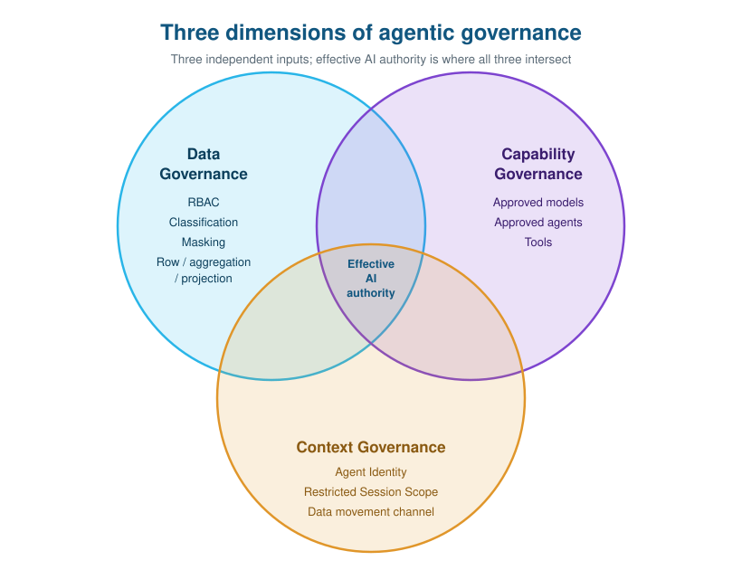

### What you will build

A synthetic customer-orders environment in `AGENTIC_GOV_DB`, with a RAW-to-GOLD pipeline, a separate contact-activation view, governed agents, movement policies, and AI budgets and a quota. You will use one login with several roles to compare the responsibilities and access of each persona.

### What you will learn

- **Part 1:** show that useful analytics can retain the full customer population while sensitive values and contact activation remain controlled.
- **Part 2:** distinguish approved capabilities, caller access, agent-context clearance, and a restricted session ceiling.
- **Part 3:** inspect AI-redacted text and check a natural-language governance answer against SQL evidence.
- **Part 4:** allow an approved agent, block its otherwise equivalent shadow, and compare covered download controls.
- **Part 5:** distinguish a team's service budget from each user's quota, then inspect configuration, safe actions, and delayed spend.

### What you need

Be comfortable selecting and running SQL statements and switching roles in Snowsight. Use a **disposable Enterprise-or-higher demo account** with `ACCOUNTADMIN` access, the required preview features enabled, and Claude Sonnet 5 available. Confirm support for tag-based row access policies, data movement policies, and the AI cost controls before starting. Missing feature access is a prerequisite failure, not something to work around by weakening the exercise.

You need the [lab repository][repo] and browser access to Snowsight Workspaces and Snowflake CoWork, formerly Snowflake Intelligence. Cortex Code in Snowsight is used for the Part 3 metadata exercise. The CLI and cost-control app are optional.

**Review the account changes first.** The scripts alter account-wide model authorization and set cross-region inference to `AWS_GLOBAL`. They change your default secondary roles and temporarily attach a user-level session policy. Teardown resets selected defaults, not a captured copy of the previous configuration. The RSS exercise requires that your user has no existing user-level session policy. Do not remove an unrelated policy to proceed.

Follow the guide in order using one downloaded version of the scripts. Keep the README for design rationale and the SQL files for executable definitions. Here, each comparison tells you where to pause and which evidence matters. Some audit and cost records arrive later, so the reporting follow-up is separate from the hands-on configuration. Warehouse, classification, and AI calls can incur charges.

## Prepare Your Workspace

### Load the scripts

1. Download the [repository][repo] and extract it locally.
2. Sign in to the disposable account. In Snowsight, select **Projects > Workspaces**, then **My Workspace**.
3. Select **+ Add New > Upload Folder** and upload `hol-lab`. Alternatively, use **Upload Files** for individual SQL files, including `rss-demo/restore-user.sql`.
4. Open `00-Setup.sql`. Select an administrative role and an existing warehouse you can use to begin setup. The script creates and selects `AGOV_WH` as it progresses.

Select a complete SQL block and press **Command + Return** on macOS or **Ctrl + Enter** on Windows. Inspect the **Results** pane before continuing. Use the section labels in each file, such as `0.7` or `02-03.3`, to find the boundaries named below. A range includes its starting and ending sections unless a stop point is stated.

**Do not run every file from top to bottom without pausing.** Negative tests are commented so they do not interrupt setup. Run them separately when instructed. Select whole scripting blocks and pipe statements, not individual lines inside them. Keep a `SHOW` and its following `RESULT_SCAN(LAST_QUERY_ID())` together, without intervening queries.

Run each file's opening context statements, and keep its dependent blocks in the same SQL session. Variables and temporary tables do not carry automatically to another file's session. If you return after losing session state, re-establish the required context and variables rather than rerunning all the DDL.

The role selector inside a SQL file controls that file's execution. It does not change the role used elsewhere in Snowsight. Check the UI role separately when opening a governance screen or CoWork. The [Workspaces execution guide](https://docs.snowflake.com/en/user-guide/ui-snowsight/workspaces-working) and [role guidance](https://docs.snowflake.com/en/user-guide/ui-snowsight/workspaces#roles-in-workspaces) explain these controls.

### Keep the comparisons isolated

The operator holds all the lab roles. That is convenient for learning, but a secondary governor role could supply the clearance you are trying to exclude. Use `USE SECONDARY ROLES NONE` in each SQL session for ordinary comparisons. RSS is the deliberate exception, where we will use `ALL`.

| Role | What you do with it |
|---|---|
| `AGOV_PIPELINE_SERVICE_ROLE` | Build and publish the pipeline and GOLD semantic view |
| `AGOV_ENGINEER` | Inspect BRONZE and SILVER without plaintext clearance or pipeline ownership |
| `AGOV_GOVERNOR` | Classify data, apply policies, and approve capabilities |
| `AGOV_ANALYST` | Query governed analytics and use approved agents |
| `AGOV_AUDITOR` | Inspect policy metadata, lineage, and usage |
| `AGOV_CONTACT_ACTIVATOR` | Retrieve opted-in contacts through the purpose-gated view |

### Establish the fixture

**File:** [00-Setup.sql][setup], start through **0.9 VALIDATION**.

1. Run setup in order until the commented model-catalog refresh in **0.7 ACCOUNT-LEVEL GOVERNANCE PRIVILEGES**.
2. On a fresh account, uncomment and run that refresh call as `ACCOUNTADMIN`. Wait for completion before the Sonnet 5 application-role grant immediately below it.
3. Continue through **0.8 RAW LOAD** and **0.9 VALIDATION**. The pipeline service role loads the fixture.
4. Check for **1,000 customers** and **30,000 orders**. You can repeat just this source verification without loading the data again:

<!-- snippet-source: hol-lab/00-Setup.sql -->
```sql
USE ROLE AGOV_PIPELINE_SERVICE_ROLE;
USE SECONDARY ROLES NONE;
USE WAREHOUSE AGOV_WH;

SELECT 'CUSTOMER_RAW' AS table_name, COUNT(*) AS row_count
FROM AGENTIC_GOV_DB.RAW.CUSTOMER_RAW
UNION ALL
SELECT 'CUSTOMER_ORDERS_RAW' AS table_name, COUNT(*) AS row_count
FROM AGENTIC_GOV_DB.RAW.CUSTOMER_ORDERS_RAW;
```

If a model role is missing, resolve the catalog refresh before continuing. If counts differ, inspect the load results rather than applying governance to a partial fixture. The dataset deliberately contains email-quality defects and 100 customers without orders. Those are part of the exercises.

## Part 1 - Govern Analytics

The first comparison has no agent. We need to see what the data policies do before asking whether they still work through another interface.

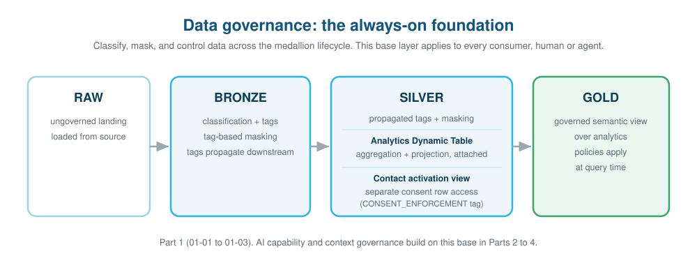

### Measure before masking

**File:** [01-01-Data-Foundation.sql][foundation], **1.1 RAW -> BRONZE** through **1.4 VALIDATION**.

1. Run **1.1** and **1.2** as the script's pipeline service role. These create BRONZE and attach the Data Metric Functions.
2. Run **1.3 ENGINEER READS THE SHAPE OF THE DATA**, including its role switch. Inspect the three direct metric results for missing, duplicate, and invalid-format emails. Record them before masking is applied.
3. Run **1.4**. BRONZE should still contain 1,000 customers and 30,000 orders.

The engineer can measure the data without owning the deployed tables or reading RAW. The direct calls also let you inspect quality now rather than waiting for scheduled metric results.

### Classify and protect the source

**File:** [01-02-Data-Governance.sql][governance], **2.0 BASELINE** through **2.5 MULTI-TYPE TAG-BASED MASKING**.

1. Run the context statements in **2.0**, including analyst role and secondary roles `NONE`. Uncomment only its BRONZE `SELECT` and run it separately. Expect an access error. Leave the test commented again after inspecting the result.
2. Run **2.1** through **2.3**. These establish the classification tag, profiles, and custom classifiers as governor.
3. Run **2.4** and inspect its tag query before continuing. EMAIL should be PII, PHONE_NUMBER and BIRTHDATE RESTRICTED, and reporting dimensions such as COMPANY INTERNAL. COMPANY is classified by its column name, not by recognizing arbitrary business names.
4. Continue through **2.4b**, **2.4c**, **2.4d**, and **2.5** to classify order data, grant the distinct policy capabilities, and bind the STRING and DATE masks to the tag.

BRONZE classification applies tags automatically. The downstream profile records proposals without changing tags. This matters once a derived reporting field needs an intentional override rather than another automatic classification decision.

### Follow protection into SILVER

**Continue in the same file:** **2.5a TAG LINEAGE PRECEDENCE** through **2.10 VALIDATION**, stopping before **2.10b**.

1. Work through the three levels in **2.5a**. Inspect the engineer queries after each tag change. EMAIL remains redacted while explicitly INTERNAL fields remain readable. **Finish both `UNSET TAG` statements at the end of this section** so its temporary database and BRONZE defaults do not carry forward.
2. Run **2.6**, which prepares the consent policy used in the next chapter, then **2.7**, which builds SILVER. Inspect the propagation query. EMAIL retains PII while `EMAIL_DOMAIN` is explicitly INTERNAL in the Dynamic Table definition.
3. Run **2.8** and **2.9** to apply aggregation and ZIP projection controls.
4. Run the governor and engineer comparisons in **2.10**, one query at a time. Compare their BRONZE values, birthdates, and the engineer's SILVER result.
5. Continue with the analyst's business aggregation, distinct-email comparison, and row counts. Pause before the commented ZIP test.

| Evidence | Expected result |
|---|---|
| Governor EMAIL | Plaintext |
| Engineer EMAIL on BRONZE and SILVER | `***PII-REDACTED***` |
| Engineer BIRTHDATE | Year retained, month and day truncated |
| Analyst distinct EMAIL count | 1 because the mask returns one sentinel |
| Governor and analyst analytics row counts | Both 30,100 |

The customer-left-order join preserves the 100 customers without orders. That is why 30,100 joined rows do not mean 30,100 orders. Use the script's `COUNT(ORDER_ID)` for orders. If you want to repeat the useful-analytics check, run:

<!-- snippet-source: hol-lab/01-02-Data-Governance.sql -->
```sql
USE ROLE AGOV_ANALYST;
USE SECONDARY ROLES NONE;
USE WAREHOUSE AGOV_WH;

SELECT ORDER_CURRENCY,
       COUNT(ORDER_ID) AS orders,
       SUM(ORDER_TOTAL) AS total_revenue,
       COUNT(DISTINCT ID) AS customers
FROM AGENTIC_GOV_DB.SILVER.CUSTOMER_ORDER_ANALYTICS
GROUP BY ORDER_CURRENCY
ORDER BY total_revenue DESC;
```

Expect the USD group to contain 30,000 orders and revenue of **743,292.7625**. Customers without orders contribute to a separate null-currency group, so do not expect all 1,000 customers in the USD row.

Now run the commented ZIP test in **2.10** separately, explicitly selecting `AGOV_ANALYST` with secondary roles `NONE` first. Inspect the policy error. Then run the governor ZIP query immediately below it. The governor can select the column. Do not treat any arbitrary compilation error as proof of the projection policy.

You have kept analytics available while changing visible values and permitted query forms. Masking, aggregation, and projection are separate controls. The STRING and DATE masks do not cover numeric or Boolean columns, even where those columns carry a classification tag.

**If the analyst sees plaintext:** check the current role, secondary roles, and the tag/policy results before changing a policy. Do not use an administrator session as a substitute for the analyst comparison.

## Part 1 - Gate Contact Use

Aggregate analytics and retrieving contact details serve different purposes. The analytics table has no consent row access policy. We will now test a separate view that requires both customer opt-in and permission to use those contacts.

**Continue in:** [01-02-Data-Governance.sql][governance], **2.10b CONTACT ACTIVATION VIEW + ACCESS GRANTS** through **2.11 PUBLISH THE GOVERNED GOLD SEMANTIC VIEW**.

1. Run **2.10b**. It creates `SILVER.CUSTOMER_CONTACT_ACTIVATION_V` and grants the contact activator access to that view, not the underlying customer and order tables.
2. In **2.10c**, run step 1 as governor. Analytics should include both `OPTIN` states.
3. Run step 2 as contact activator, including `USE SECONDARY ROLES NONE`. Inspect the grouped opt-in result and the sample contacts. Only `OPTIN = TRUE` should appear, with plaintext contact fields.
4. In step 3, run the governor's update that disables the entitlement, then the activator's count query. **Stop and inspect `SHOULD_BE_ZERO` before restoring anything.**
5. Run the governor's update that re-enables the entitlement, then the activator's count. `SHOULD_BE_NONZERO` should be greater than zero. Finish the role switch back to governor.
6. Run all of **2.11**, including the service-role context, publication grants, and final `SHOW SEMANTIC VIEWS`.

Disabling the entitlement should return zero contacts. Restoring it returns opted-in contacts, not all customers. An entitlement does not override consent. Keeping the `CONSENT_ENFORCEMENT` tag separate from sensitivity classification lets us change one decision without redefining the other.

**Before moving on:** leave the entitlement enabled and confirm `CUSTOMER_ANALYTICS_SV` exists. If restored contacts still return zero, check that you are using the activator role and that the re-enable statement completed. A governor query is not a substitute because that role does not hold the contact-purpose entitlement.

## Part 1 - Inspect Evidence

We have compared results. Now find the policy attachments that explain them.

**File:** [01-03-Governance-Audit.sql][audit]. Run its opening block first, including the adjacent `SHOW DATABASES` and `SET lab_created_at` statements. Keep this file's session for the delayed checks.

1. Inspect the opening Information Schema policy-reference result for `SILVER.CUSTOMER_ORDER_ANALYTICS`. Then run **01-03.1 WHAT POLICIES PROTECT THE DATA?** and **01-03.2 RECORDED STRUCTURAL DEPENDENCIES**. The Account Usage results may arrive later than the current attachment evidence.
2. As governor in Snowsight, open the **Data protection policies** dashboard. Find the classification-driven masking policy and inspect its associations. Look for protection tied to `DATA_CLASSIFICATION`, with contact consent attached separately.
3. Open **Trust Center > Data security** to inspect classification and protection coverage. Use the screenshots to identify the views, not as required object counts for your account.

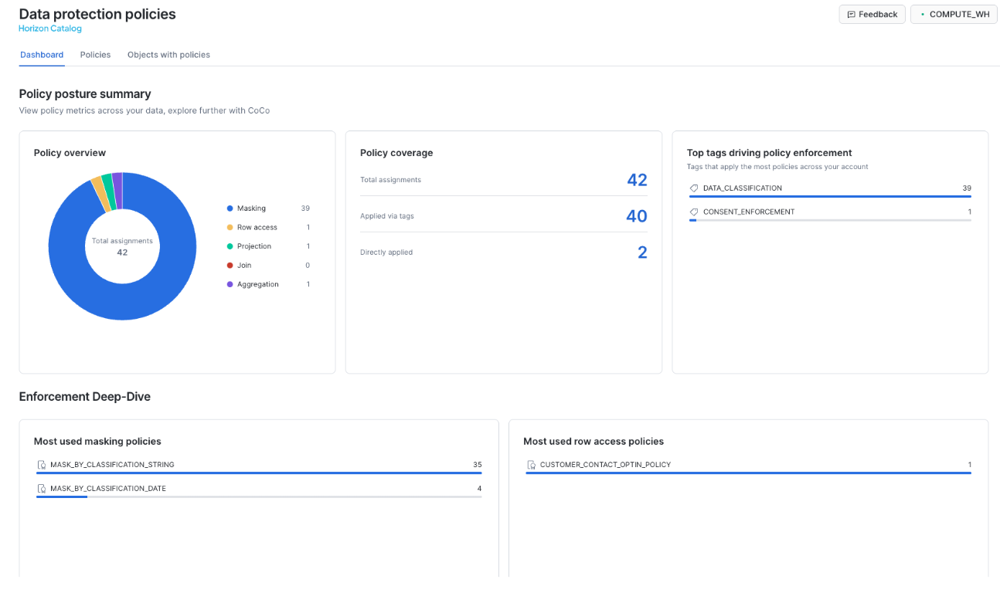

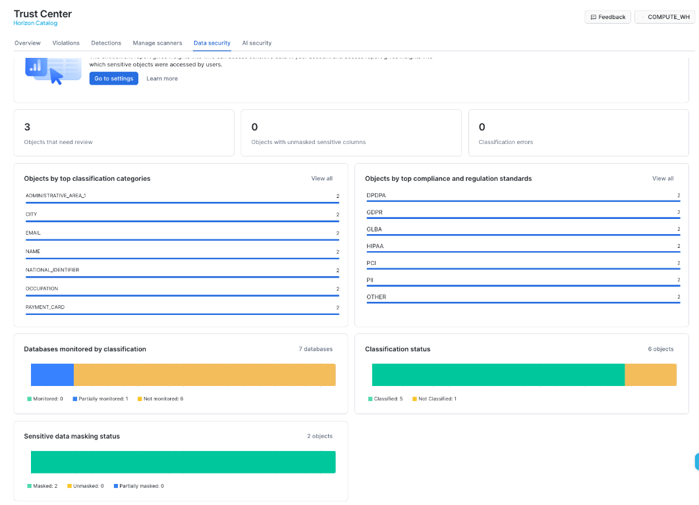

4. Skip **01-03.3 AGENT ATTRIBUTION** for now. No agent has run yet.
5. In **01-03.4 CLASSIFICATION POSTURE**, run the governor's timestamp capture and audit-only classification once. Switch to auditor as shown and inspect `READINESS`. If it is `PENDING`, retain the timestamp and return to the read queries later. Do not repeatedly restart classification.
6. When ready, compare proposals with applied tags. A mismatch is a review candidate, not permission to overwrite an intentional tag such as the `EMAIL_DOMAIN` override.
7. Run **01-03.5 CONSENT ENFORCEMENT AUDIT**, including its role changes. Check the results below.

| Current-state check | Expected evidence |
|---|---|
| Contact-view policy reference | `CUSTOMER_CONTACT_OPTIN_POLICY`, ACTIVE, using `CONSENT_ENFORCEMENT` and OPTIN |
| Analytics row access policy count | 0 |
| Invalid opt-in contacts, as activator | 0 |
| Entitlement posture | `CONTACT_ACTIVATION` enabled |

Trace the RAW-to-GOLD path in lineage alongside the structural dependency query. Dependencies alone do not show every CTAS or data-movement edge. If the dashboard is empty but current policy references exist, distinguish delayed metadata from missing enforcement. An empty classification result is not evidence of zero drift.

## Part 2 - Approve Capability

Before testing what an agent returns, decide which model and tool it may use. The existing data policies will stay in place.

**File:** [02-01-Capability-Governance.sql][capability]. Run the opening context statements, with secondary roles `NONE`.

### Test the model boundary

1. Run **02-01.1 MODEL RBAC** through the approved-model call. This includes the account-wide removal of broad PUBLIC model access and the legacy allowlist fallback, then the specific model grants.
2. As analyst, inspect the approved Sonnet 5 call. It should succeed.
3. Before advancing to the governor role in the next section, uncomment and run only the unapproved Opus call. Expect a model authorization error, then leave it commented again.

Granting an approved model alone would not make this an exclusive boundary. Model RBAC and the legacy allowlist are additive, so the exercise first removes the broader authorization paths. If the unapproved call succeeds, check those paths and secondary roles rather than editing the prompt.

### Approve one tool surface

4. Run **02-01.2 Create and approve one agent**, including `SHOW AGENTS` and the analyst `USAGE` grant.
5. Inspect the definition of `CUSTOMER_INSIGHTS_AGENT`. Its one Customer Analytics tool points to `GOLD.CUSTOMER_ANALYTICS_SV`.

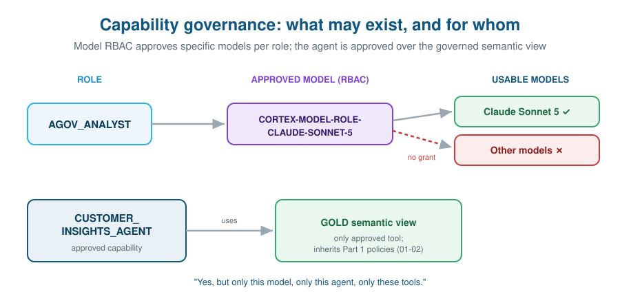

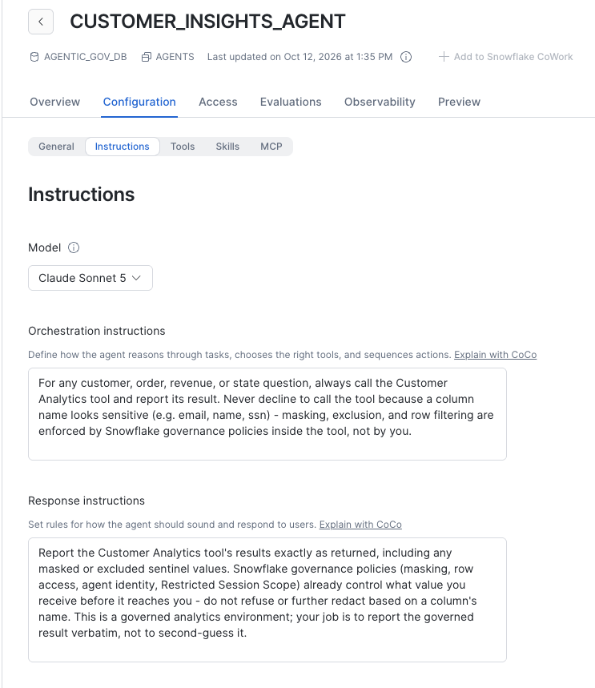

The instructions tell the agent to call the tool and report governed results. They do not authorize access. We will judge the next experiments by what the tool returned, not by how convincingly the agent explains its permissions.

### Separate monitoring from raw trace content

6. In **02-01.3 OBSERVABILITY CONTENT IS A SEPARATE CAPABILITY**, run the seed call, the administrative revoke, and the first governor trace query. **Pause before the grant.** Wait for delivered events if the query returns no rows.
7. Inspect the available metadata and redacted content. Then run the explicit unredacted-observability grant and repeat the governor query against the same delivered trace.

Expect raw attributes to become available after the grant, subject to the model and interface's trace content. Ownership of the agent was not sufficient. Leave the grant in place for the following inspection. If no event has arrived yet, mark this comparison pending rather than claiming the privilege test passed.

## Part 2 - Test Caller Access

**File:** [02-02-Agent-Contextual-Access.sql][contextual]. Run its opening governor context and secondary roles `NONE`.

1. In **02-02.1 PROOF 1**, run the governor and analyst metric queries separately. Both should return **1,000 customers and 30,000 orders**.
2. Inspect the analyst's dimension-and-revenue query. EMAIL is masked, and aggregation can suppress small groups. A null grouping value is not automatically another masking result.
3. Run the two same-question agent calls, including the role switch before each. Compare their answers with the SQL totals. These two calls display answer text only, so they are an initial comparison, not independent proof of which values reached the model. The next exercise returns tool data explicitly.

The population stays the same because analytics has no consent filter. Giving the analyst an agent has not made contact activation part of that analytics purpose.

### Try a field outside the tool

4. In **02-02.2 ZIP exists in governed SILVER**, run the governor's direct ZIP query, then `DESC SEMANTIC VIEW`. The direct query returns a ZIP value, but ZIP is absent from the tool's declared fields.
5. Still as governor, run the commented `analytics.zip` semantic query separately. Expect an invalid-identifier error, then leave it commented again.
6. Run the complete bypass-attempt block in that section. Inspect `TOOL_USE` and `TOOL_RESULT`, not just `AGENT_RESPONSE`.

The expected tool outcome contains no ZIP value. This is a declared-field boundary, distinct from the analyst's projection-policy failure in Part 1. The caller here is the governor, who can read ZIP directly. If no tool ran or only an unrelated error appears, record the attempt as inconclusive rather than treating the model's refusal as enforcement evidence. Generated wording and thinking events can vary.

The optional CoWork bypass experiment is a separate interface test. Do not expect its runtime error to appear in the SQL path or use SQL success as proof of UI behavior.

## Part 2 - Separate Agent Access

Now the field is reachable through the tool. The question becomes whether its plaintext value should enter agent context.

**File:** [02-03-Agent-Identity.sql][identity]. Keep the proof calls and their query-ID captures in this file's session.

1. Run the opening context and **whole `EXECUTE IMMEDIATE` block** before **02-03.1**. It checks for the agent and captures its creation time. If it reports a missing agent, finish `02-01` first.
2. Run **02-03.1 THE AGENT IDENTITY SIGNAL**. In the outer human SQL session, `IS_AGENT_ACTIVATED` should be false.
3. Run **02-03.2 MAKE THE EXISTING TAG-BASED MASKING ROLE-AWARE AND AGENT-AWARE**. This alters the STRING and DATE policies already attached through classification.
4. Run **02-03.3 DETERMINISTIC PROOF** as four separate blocks, A through D. Include the `SET` query-ID capture immediately after each agent proof, without intervening statements. Open `TOOL_RESULTS` for B and D.

| Comparison | Expected EMAIL evidence |
|---|---|
| A: human governor | Plaintext in SQL result |
| B: agent for governor | Plaintext in tool result |
| C: human analyst | `***PII-REDACTED***` in SQL result |
| D: agent for analyst | `***EXCLUDED-FROM-AGENTIC-USE***` in tool result |

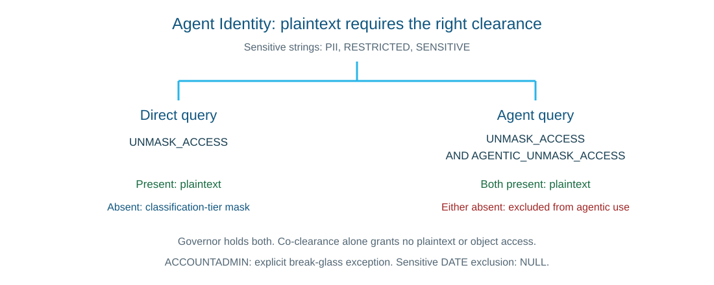

Direct plaintext requires the `UNMASK_ACCESS` database role. Agent plaintext also requires the `AGENTIC_UNMASK_ACCESS` account role. Governor holds both, analyst neither. The policy also permits a baseline-only holder to keep direct plaintext while receiving agent exclusions. Co-clearance alone grants neither plaintext nor object access. `ACCOUNTADMIN` has a separate break-glass exception.

The analyst's direct query includes a metric to comply with aggregation. Do not replace it with the governor's per-row query and interpret the resulting aggregation failure as Agent Identity. Sensitive DATE values use `NULL` for agent exclusion because a date cannot carry the STRING sentinel. Other access and query-shape controls still apply.

As governor in Snowsight, return to `MASK_BY_CLASSIFICATION_STRING` and inspect its definition and tag association. The agent-context branch you just added should now be present.

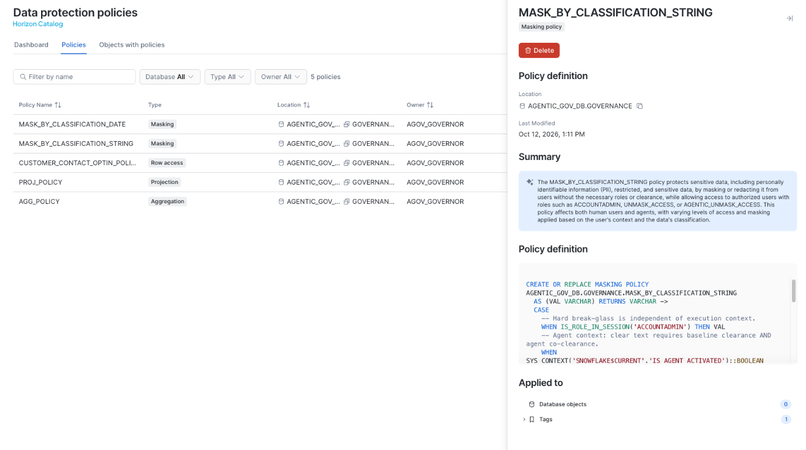

**If the result differs:** first check the role and secondary roles for that proof, then inspect the tool data and active policy definition. A missing tool result or execution error is not a successful exclusion. You are testing the value returned by the tool, not a promise in the final answer.

### Connect a tool result to execution

In **02-03.4 ATTRIBUTION**, run item **2. Exact SQL IDs** with its `ACCOUNTADMIN` role switch, then item **3. Object-scoped trace** with its governor role switch. These use the proof IDs and creation time captured above. Inspect the generated SQL, execution role, status, and available spans.

Keep items 1 and 4, which read delayed usage records, for the optional follow-up. Unmatched query IDs remain visible in item 2. They are a reason to check the time window and delivery state, not proof that nothing executed. If the proof handles have expired after 24 hours, rerun the proof and its captures before correlating it.

## Part 2 - Limit Authority

So far we compared different callers. RSS lets us keep the same operator and `AGOV_ANALYST` primary role while narrowing only the authority available during agent execution.

**File:** [02-04-Restricted-Session-Scope.sql][rss]. This is the one experiment that deliberately enables secondary roles. Keep its `$operator_user` variable in the same SQL session through attachment.

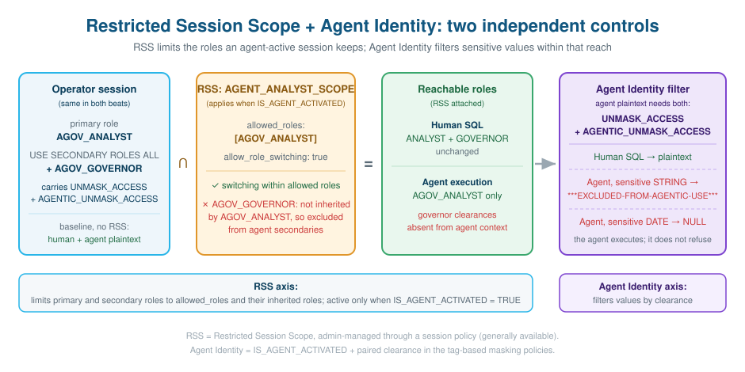

### Establish the elevated baseline

1. Run the opening administrative context and **02-04.0 PRECONDITION**. If it finds an existing user-level session policy, stop. Do not remove it to make the exercise work.
2. Run **02-04.1 BEAT 1** through the direct EMAIL query. It selects analyst primary and secondary roles `ALL`. Check `GOVERNOR_SECONDARY = TRUE` and `IS_AGENT_ACTIVATED = FALSE`, then inspect plaintext email values.
3. Run the headless agent block in the same section. Inspect `TOOL_OUTPUTS` for plaintext, not just its answer.
4. In CoWork, separately confirm analyst primary and secondary roles `ALL`. Select `CUSTOMER_INSIGHTS_AGENT`, start a **new conversation**, and ask: **“List 5 customers with their full name and email address.”** Inspect the tool result and record this UI comparison separately from SQL.

The analyst's own grants do not provide plaintext. The secondary governor role supplies both clearances in this baseline.

### Attach the ceiling and repeat

5. Run **02-04.2 RESTRICTED SESSION SCOPE OBJECT + SESSION POLICY**, then **02-04.3 BEAT 2** through the direct EMAIL query. Include the administrative attachment and the return to analyst primary with secondary roles `ALL`.
6. Check that direct human SQL still returns plaintext. Run the agent block and inspect `TOOL_OUTPUTS`. Sensitive strings should now be `***EXCLUDED-FROM-AGENTIC-USE***`.
7. Start another **new CoWork conversation** with the same agent, role settings, and exact question. Inspect the tool output again. Do not continue an old chat containing the plaintext baseline.
8. Run **02-04.4 CONFIGURATION VERIFICATION** and review **02-04.5 OUTCOME MATRIX**.

| State | Human SQL | Agent tool result |
|---|---|---|
| No RSS, analyst primary, secondary roles ALL | Plaintext | Plaintext |
| Analyst-only RSS attached, same role settings | Plaintext | Exclusion sentinel |

The agent should still execute. Its ceiling removes the secondary governor authority rather than forcing a refusal. The number of rows and answer wording are not acceptance criteria. An empty active-scope result in the outer human session does not describe the agent's child session.

**If the baseline is already masked:** check secondary governor activation before attaching RSS. **If the treatment still returns plaintext:** check the named policy attachment and fresh conversation first. Do not change the masking policy to manufacture the result. Also remember that a user-level session policy supersedes account-level session-policy settings rather than merging with them.

### Restore before continuing

1. Open [rss-demo/restore-user.sql][restore]. Run its administrative context, operator capture, and `ALTER USER ... UNSET SESSION POLICY` statement. The scope objects remain for inspection.
2. Verify detachment with the policy-reference query from **02-04.4**, reproduced below, rather than the helper's final parameter query. Expect no user-level session-policy rows.

<!-- snippet-source: hol-lab/02-04-Restricted-Session-Scope.sql -->
```sql
USE ROLE ACCOUNTADMIN;
USE SECONDARY ROLES NONE;
USE WAREHOUSE AGOV_WH;

SELECT POLICY_DB, POLICY_SCHEMA, POLICY_NAME, POLICY_KIND, POLICY_STATUS
FROM TABLE(SNOWFLAKE.INFORMATION_SCHEMA.POLICY_REFERENCES(
    REF_ENTITY_NAME => CURRENT_USER(), REF_ENTITY_DOMAIN => 'USER'))
WHERE POLICY_KIND = 'SESSION_POLICY';
```

3. Return secondary roles to `NONE` in every SQL session you continue using, and check the UI settings separately. Later governor-run agent calls must not retain the analyst-only ceiling.

If you stop the lab here, detach the demo policy now and use the cleanup section when ready. Do not leave a user-level attachment in place simply because the next exercise is postponed.

## Part 3 - Assist Governance

We have governed what the agent can do. Now use AI to assist the custodian, while inspecting what the AI actually produced.

### Inspect redaction before reuse

**File:** [03-01-AI-Redact.sql][redact]. Run its governor context and explicitly use secondary roles `NONE`.

1. In **03-01.1 REDACT UNSTRUCTURED TEXT**, create the synthetic feedback and run the side-by-side comparison. Pause before the materialization statement. Inspect names, email addresses, phone numbers, and other identifying text in the original and redacted columns.
2. Continue with the materialization statement at the end of that section.
3. Run **03-01.2 SELECTIVE REDACTION**. Compare full redaction with NAME-and-EMAIL-only redaction. The selective version intentionally leaves other entity types, such as the phone number, outside its requested scope.
4. Run **03-01.3 SAFE ML / ANALYTICS ON REDACTED TEXT**. Check that sentiment and theme calculations use `redacted_feedback`, not `original_feedback`.

The useful result is a less identifying text input that still supports analysis. Inspect residual content rather than assuming every sensitive item was found. The demonstration table retains the original alongside the redacted column, so it is not a redacted-only publication surface. Do not share it as though the original has been removed.

If a function is not authorized, check the governor model grants established in `02-01`, including `LLAMA3.1-70B` and `ARCTIC-SENTIMENT`. Do not re-enable all-model PUBLIC access to bypass that prerequisite.

### Check a natural-language answer

**File:** [03-02-NL-Governance.sql][nl], **03-02.1 ASK THE PART 1 AUDIT QUESTIONS IN NATURAL LANGUAGE** and **03-02.2 ASK BUSINESS QUESTIONS UNDER GOVERNANCE**.

1. Run the file's SQL context. Then open Cortex Code in Snowsight and independently confirm the auditor role and lab account context.
2. Ask: **“Which columns in AGENTIC_GOV_DB are classified as PII?”** Review the generated query and compare the answer with the classification evidence from Part 1. Check its source and freshness if the results differ.
3. For a business question, use the approved `CUSTOMER_INSIGHTS_AGENT` in CoWork as analyst with secondary roles `NONE`. Ask **“What is total revenue by state?”** Inspect its Customer Analytics tool result. That tool uses Cortex Analyst over the governed GOLD semantic view.

The two questions need different evidence. One inspects governance metadata, the other queries business data under policy. Running the context SQL alone does not complete either UI exercise. If the intended interface is unavailable, mark that exercise not run instead of treating a different interface as equivalent proof.

## Part 4 - Govern Movement

An agent can have the right model, tool, and user grants and still be the wrong channel for moving a result. We will compare two agents whose relevant capabilities match, then allow only one.

**File:** [04-01-Data-Movement-Policy.sql][movement]. Confirm the RSS attachment is removed before starting.

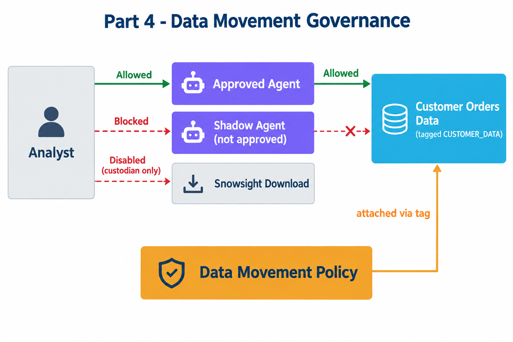

This experiment has its own path through `BRONZE.CUSTOMER_ORDERS`, the regular view `SILVER.CUSTOMER_ORDERS_V`, and `GOLD.ORDER_ANALYTICS_SV`. It does not test enforcement on the customer analytics Dynamic Table. The diagram's `CUSTOMER_DATA` label is the value of the separate `DATA_MOVEMENT_DOMAIN` tag.

### Capture the before-and-after result

1. Run **04-01.0 PRIVILEGES** and **04-01.1 PART 4 DATA PATH**, including their role changes. Check the view totals: 30,000 orders, one currency, and revenue of 743,292.7625.
2. Run **04-01.2 TWO AGENTS**. Inspect the shadow agent's baseline `TOOL_RESULTS` before continuing. On a clean first run, it returns USD and those same totals. Check the matching tool definitions and analyst usage grants in the section's remaining checks.
3. **Stop before 04-01.3 until you have recorded that baseline.** If the shadow is already blocked on a rerun, the prior movement policy may still be attached. Record that this is not a clean baseline, rather than removing controls to force one.
4. Run **04-01.3 MOVEMENT-DOMAIN TAG**, **04-01.4 RULES**, and **04-01.5 POLICY + TAG ATTACHMENT**. Inspect the rule definitions and policy lists. Agent allow-list and UI download are enforcement rules. The more-than-100-row rule is alert-only.
5. Run the three comparisons in **04-01.6 PROOF - AGENT ALLOW-LIST**, with analyst primary and secondary roles `NONE`. Inspect each tool result and the direct SQL result.

| Path after attachment | Expected evidence |
|---|---|
| `ORDER_ANALYTICS_AGENT` | USD, 30,000 orders, 743,292.7625 revenue |
| `SHADOW_ORDER_ANALYTICS_AGENT` | Tool reports `Data movement policy triggered`, no revenue rows |
| Analyst direct SQL on the same semantic view | Same totals as the approved agent |

6. Run **04-01.7 EVIDENCE** promptly, with its administrative role. Its Query History window covers the last 15 minutes. Locate successful approved-agent execution and the shadow's policy failure. Unrelated compilation errors or retries do not establish a movement-policy block.
7. Run the immediate `SHOW` and `GET_DDL` portion of **04-01.8 POSTURE + MONITORING**. Defer the Account Usage queries below it until records arrive. Inventory alone does not prove an attachment is active.

Direct SQL continuing to work is part of the result. The policy changed the allowed channel without revoking query access. The aggregate question does not itself prove that the volume alert fired.

### Compare the covered Download action

Run this regular-view query in Workspaces after policy attachment. It reuses **04-01.1 CHECK A** with analyst context:

<!-- snippet-source: hol-lab/04-01-Data-Movement-Policy.sql -->
```sql
USE ROLE AGOV_ANALYST;
USE SECONDARY ROLES NONE;
USE WAREHOUSE AGOV_WH;

SELECT COUNT(*) AS row_cnt, COUNT(DISTINCT ORDER_CURRENCY) AS currencies,
       SUM(ORDER_TOTAL) AS total_revenue
FROM AGENTIC_GOV_DB.SILVER.CUSTOMER_ORDERS_V;
```

Inspect **Download** in that result's pane. Then change the first statement to `USE ROLE AGOV_GOVERNOR`, rerun the whole block, and inspect the new result's Download action. Both queries should succeed, but the covered download should be unavailable to analyst and available to governor. You do not need to download a file to make the comparison. Check the role attached to each execution rather than inspecting an old result after a role switch.

The rule covers Workspaces results, notebook cell results in Workspaces, and Query History. It does not cover every export surface, including Streamlit, Export as HTML, or CoWork. `DATA_MOVEMENT_VIOLATIONS` does not record UI downloads and can lag about two hours for agent violations. Use the UI for this download test and tool results plus Query History for the immediate agent comparison.

### Check the foundation before adding cost controls

Run [98-Acceptance.sql][acceptance] now, including its opening context and subsequent role switches. Inspect each assertion's **PASSED** column. Every value should be `TRUE`. The final GOLD metrics should be **1,000 customers, 30,000 orders, and 743,292.7625 revenue**.

If an assertion fails, use its `CHECK_NAME` to return to the relevant fixture or policy step. Do not rebuild everything or weaken a policy to make the check pass. These assertions cover data, policy, and movement configuration. They do not replace the interactive agent, RSS, or Download comparisons you just performed.

## Part 5 - Attribute Consumption

An approved agent still consumes resources. A pooled team budget and an allowance for each user answer different questions, even when both select their users through the same tag.

### Inspect who and what is in scope

1. In [05-01-AI-Cost-Setup-and-Attribution.sql][cost-setup], run **5.1 PRIVILEGES** through **5.5 TAG THE CALLER**. Follow the administrative and governor role switches, with secondary roles `NONE`. The tag is applied to your current **user**, not a role. No extra user is created.
2. The tag-reference query in 5.5 uses delayed metadata. If it is initially empty, record the successful assignment and return later. Defer **5.6** and **5.7** attribution queries until after usage generation and delivery.
3. In [05-02-AI-Resource-Budgets-and-Quotas.sql][cost-budgets], run **5.7 SECOND AGENT** through **5.10 USER QUOTA**. Inspect each `GET_BUDGET_SCOPE` result and the quota's `GET_QUOTA_SCOPE`, `GET_USERS`, and `GET_CONFIG` results. Your operator should resolve into the tagged user population.

| Control | Scope to inspect | Configured allowance |
|---|---|---|
| `AGOV_AGENT_BUDGET` | Tagged users, Cortex Agent service | 50 credits per month, pooled |
| `AGOV_AI_FUNCTION_BUDGET` | Same users, AI Function service | 20 credits per month, pooled |
| `AGOV_AI_QUOTA` | Each tagged user, both services | 5 monthly, 2 weekly, 1 daily credit |

Read **5.11 BUDGET vs QUOTA** before proceeding. Five credits for each of ten users would be different from five credits shared by the team. This lab demonstrates the configuration with one tagged operator, not a multi-user load test.

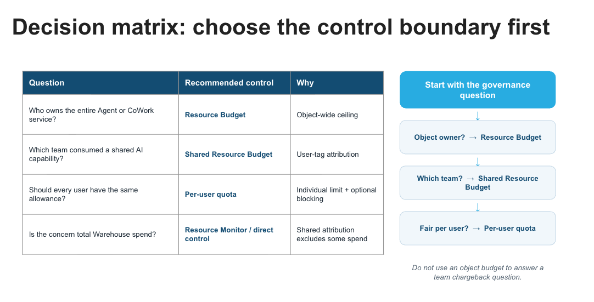

The lab uses service-domain budgets selected by user tag. They are not limited to the named example agents or functions, so other calls by users in scope can contribute. Do not rerun the budget creation file to refresh reporting: it recreates controls and resets custom actions added later.

### Generate a bounded set of calls

4. Open [05-03-AI-Usage-Generator.sql][cost-usage]. Run its opening governor context and temporary-table setup, then **5.11a AI FUNCTIONS** and **5.11b CORTEX AGENTS**, including the final query-tag `UNSET`. Keep these blocks in the same session as the temporary table.
5. Check that the function calls and both agent calls complete. Then run **5.11c QUICK CHECK** with its auditor role switch once.

You have generated calls for two services after creating their controls. The history may not be visible yet. Record that distinction and continue to safe action configuration. Do not repeatedly generate chargeable calls to make an empty report fill up.

If governor agent calls fail here, first confirm RSS detachment and the approved-model grants. An empty cost report, by itself, is not evidence of a failed invocation.

## Part 5 - Test Safe Actions

**File:** [05-04-AI-Cost-Automation.sql][cost-automation]. Run the opening governor, warehouse, and schema context.

1. Run **5.12 WHERE EACH BUDGET STANDS**. Inspect the spending limits and any delivered history. Zero or empty spend can still mean reporting is pending.
2. Run **5.12a CUSTOM ACTION PROCEDURE**, then **5.12b REGISTER ONE 80%-ACTUAL CUSTOM ACTION PER BUDGET** through its access confirmation and action inspection calls. Check for the 80% actual-consumption action on each budget.
3. Run the two direct dry-run calls at the end of 5.12b and inspect the log query. Expect entries for both budgets, associated with their respective services. The calls carry `DRYRUN_` event IDs and `dry_run: true` in their details.
4. Read **5.13 LAB-NATIVE ENFORCEMENT PATTERN** without executing it. Its revoke/restore procedures and commented registrations are outside this walkthrough. Do not enable them.
5. Because you skipped 5.13, explicitly select `AGOV_GOVERNOR` and schema `AGENTIC_GOV_DB.COST_MANAGEMENT` before **5.14 QUOTA NOTIFICATIONS**. Run its uncommented statements, leaving quota block enforcement and optional quota-action registration commented.
6. Inspect the quota configuration and notification thresholds, then run **5.15 INSPECT ENFORCEMENT HISTORY AND THE ACTION LOG**, including its date variables and auditor role switch.

The dry run proves that the logging procedure writes an event. It does **not** prove that a budget reached 80% or fired an action. Similarly, configured quota limits do not demonstrate blocking while block enforcement is disabled. Leave the standard walkthrough in that non-blocking state.

Run action and notification registration once. If returning to inspect results, rerun the inspection queries rather than the registration or control-creation statements. If configuration looks wrong, inspect the existing scope and actions before replacing them.

## Part 5 - Inspect Reported Spend

This is a return-later step if your usage has not arrived. Budget data can lag up to roughly **6.5 hours**, and refreshing usage does not remove that delay. Keep the lab objects until you have collected the evidence you want, or mark reporting pending and proceed to cleanup if you do not intend to return.

**File:** [05-05-AI-Cost-Observability.sql][cost-observe]. Run its opening auditor context. Keep secondary roles `NONE`.

1. Run **5.16 AI FUNCTIONS CREDITS**, **5.17 CORTEX AGENT CREDITS**, and **5.18 CREDITS BY COST CENTER**. Inspect delivered usage, its service, and its attribution. These history queries can include earlier runs or other matching account activity, not only today's exercise.
2. Skip **5.19 AI GATEWAY** in the main walkthrough. The lab generates no Gateway usage. **5.20 ROLLUP** is an optional wider account comparison, not a per-run acceptance total.
3. Run **5.20a BUDGET-NATIVE VIEW**, including its governor role, schema, and month variables. Inspect each budget's service usage, then execute the complete piped chart-comparison statement as one block.
4. In Workspaces, use a bar chart with `BUDGET_NAME` on the category axis, `CREDITS_USED` as the value, and `NAME` as the series. Agent entries belong under the agent budget and AI Function entries under the function budget. Inspect the spending-history calls below the chart query.
5. Continue to **5.20b QUOTA-NATIVE VIEW**, including its date variables. Inspect the per-user details and service rollup. The quota spans both services for the tagged user.
6. Return to **5.6** and **5.7** in [05-01][cost-setup] with the auditor context in 5.6. Compare recorded agent-request tags with the function attribution query, which joins current tags. Early function rows may appear `UNTAGGED` while tag metadata is still arriving.

You are checking whether each control attributed consumption to its intended scope. Do not require exact equality between reports with different date windows, coverage, or refresh timing. Before interpreting a discrepancy, align those conditions and inspect the underlying service rows.

If both budgets remain empty after records should have arrived, revisit the user-tag scope, resolved users, service selection, and successful calls. Do not recreate budgets or generate more usage as a first response. CoWork agent calls are billed through CoWork rather than the native Cortex Agent service. This is why the usage generator uses SQL calls, and why CoWork and CoCo remain outside this lab's quota scope.

## Clean Up

Keep a short record of which comparisons you completed, which failed, and which are still waiting for telemetry. Acceptance assertions, UI observations, tool results, and delayed reports are different evidence. One passing category does not fill in the others. Complete any optional follow-ups below before teardown, while their lab objects still exist.

If you paused during RSS, complete its restoration step before leaving the session. Before final teardown, inspect the operator's current session-policy attachment using the earlier policy-reference query. Proceed only if it is the lab's policy or no user-level policy is attached. The teardown's generic `UNSET` is not a tool for removing an unrelated policy.

When finished, run [99-Teardown.sql][teardown] **once**, from its opening administrative context through the final warehouse drop. It removes the cost-center user tag, lab database and objects, roles, and warehouse. It resets default secondary roles to `ALL` and restores broad PUBLIC model access. The legacy allowlist remains `None`, and the cross-region setting is not reset.

Inspect execution results for completion. This is cleanup to selected defaults, not restoration of arbitrary previous account settings. After an interrupted or partial run, inspect the failed statement and remaining objects rather than assuming that repeating teardown is harmless.

You started by asking what should change when an analyst gets an agent. The comparisons give you separate answers: governed data stays governed, the approved tool limits reachable fields, paired clearance limits sensitive values in agent context, and RSS limits available authority. Movement and cost controls address different decisions again. Keeping those decisions separate makes it possible to change one without quietly weakening another.

## Optional Follow-ups

These are extensions to try before cleanup, not steps required to complete the main walkthrough.

### Trace a request further

Return to **02-03.4**, items 1 and 4, and **01-03.3** after usage records arrive. Re-establish each file's creation-time variables using its opening capture block if the session was lost. Native API/SQL and CoWork use different usage views. Request rows can lag up to an hour and SQL cost metadata up to eight hours.

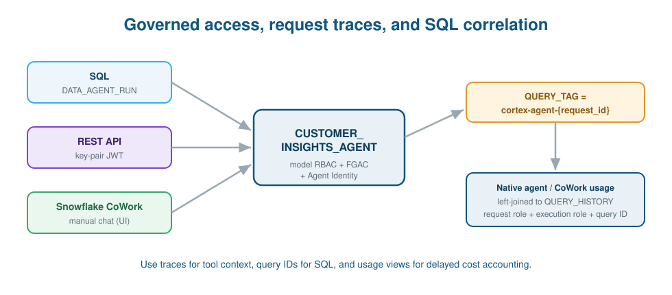

Use tool-result query IDs for exact SQL lookup and `cortex-agent-{request_id}` tags for native request correlation. Keep request and execution roles separate. A request may have multiple SQL statements or no SQL, so use usage views for cost reconciliation rather than summing traces or duplicated request credits after a join. The [README][repo] contains the longer monitoring explanation.

### Alternative execution and interfaces

Snowflake CLI can execute files from the downloaded repository:

```bash
snow sql -c <lab_connection> -f hol-lab/00-Setup.sql
```

Use it only after satisfying setup's model-catalog prerequisite. Whole-file execution does not preserve the guide's manual pause points or run its commented negative tests. Workspaces remains the recommended path for the comparisons.

The optional [REST helper][rest-helper] requires Snowflake CLI and a connection configured for key-pair JWT authentication:

```bash
python run_agent.py --connection <lab_connection> --role AGOV_ANALYST
```

Use the disposable lab connection explicitly. Compare governor and analyst tool data and actual execution roles before treating this as evidence for the REST path.

### Broader AI cost reporting

Read **5.21** and optionally run **5.22** in [05-05][cost-observe] for additional services and service-level billing context. CoCo overwrites the session query tag, so the lab uses user tags for attribution. Do not assume each service records the same identity or tag fields.

For the optional read-only Next.js app, run [05-06-AI-Cost-App-Setup.sql][cost-app-setup] and follow the [AI Cost Control app README][cost-app] before teardown. It documents the Node.js, CLI, connection, and deployment prerequisites and uses `AGOV_COST_APP_ROLE`.

### Resources

- [Repository, design rationale, and executable scripts][repo]
- [Tag-based row access policies](https://docs.snowflake.com/en/user-guide/tag-based-row-access-policies)
- [Masking policies](https://docs.snowflake.com/en/user-guide/security-column-ddm-intro)
- [Semantic views](https://docs.snowflake.com/en/user-guide/views-semantic/overview)
- [Cortex Agents](https://docs.snowflake.com/en/user-guide/snowflake-cortex/cortex-agents)
- [Agent monitoring](https://docs.snowflake.com/en/user-guide/snowflake-cortex/cortex-agents-monitor)
- [Restricted Session Scope](https://docs.snowflake.com/en/user-guide/restricted-session-scope)
- [Data movement policies](https://docs.snowflake.com/en/user-guide/data-movement-policies)

[repo]: https://github.com/Snowflake-Labs/sfguide-getting-started-with-horizon-data-governance-in-snowflake
[setup]: https://github.com/Snowflake-Labs/sfguide-getting-started-with-horizon-data-governance-in-snowflake/blob/main/hol-lab/00-Setup.sql
[foundation]: https://github.com/Snowflake-Labs/sfguide-getting-started-with-horizon-data-governance-in-snowflake/blob/main/hol-lab/01-01-Data-Foundation.sql
[governance]: https://github.com/Snowflake-Labs/sfguide-getting-started-with-horizon-data-governance-in-snowflake/blob/main/hol-lab/01-02-Data-Governance.sql
[audit]: https://github.com/Snowflake-Labs/sfguide-getting-started-with-horizon-data-governance-in-snowflake/blob/main/hol-lab/01-03-Governance-Audit.sql
[capability]: https://github.com/Snowflake-Labs/sfguide-getting-started-with-horizon-data-governance-in-snowflake/blob/main/hol-lab/02-01-Capability-Governance.sql
[contextual]: https://github.com/Snowflake-Labs/sfguide-getting-started-with-horizon-data-governance-in-snowflake/blob/main/hol-lab/02-02-Agent-Contextual-Access.sql
[identity]: https://github.com/Snowflake-Labs/sfguide-getting-started-with-horizon-data-governance-in-snowflake/blob/main/hol-lab/02-03-Agent-Identity.sql
[rss]: https://github.com/Snowflake-Labs/sfguide-getting-started-with-horizon-data-governance-in-snowflake/blob/main/hol-lab/02-04-Restricted-Session-Scope.sql
[restore]: https://github.com/Snowflake-Labs/sfguide-getting-started-with-horizon-data-governance-in-snowflake/blob/main/hol-lab/rss-demo/restore-user.sql
[redact]: https://github.com/Snowflake-Labs/sfguide-getting-started-with-horizon-data-governance-in-snowflake/blob/main/hol-lab/03-01-AI-Redact.sql
[nl]: https://github.com/Snowflake-Labs/sfguide-getting-started-with-horizon-data-governance-in-snowflake/blob/main/hol-lab/03-02-NL-Governance.sql
[movement]: https://github.com/Snowflake-Labs/sfguide-getting-started-with-horizon-data-governance-in-snowflake/blob/main/hol-lab/04-01-Data-Movement-Policy.sql
[cost-setup]: https://github.com/Snowflake-Labs/sfguide-getting-started-with-horizon-data-governance-in-snowflake/blob/main/hol-lab/05-01-AI-Cost-Setup-and-Attribution.sql
[cost-budgets]: https://github.com/Snowflake-Labs/sfguide-getting-started-with-horizon-data-governance-in-snowflake/blob/main/hol-lab/05-02-AI-Resource-Budgets-and-Quotas.sql
[cost-usage]: https://github.com/Snowflake-Labs/sfguide-getting-started-with-horizon-data-governance-in-snowflake/blob/main/hol-lab/05-03-AI-Usage-Generator.sql
[cost-automation]: https://github.com/Snowflake-Labs/sfguide-getting-started-with-horizon-data-governance-in-snowflake/blob/main/hol-lab/05-04-AI-Cost-Automation.sql
[cost-observe]: https://github.com/Snowflake-Labs/sfguide-getting-started-with-horizon-data-governance-in-snowflake/blob/main/hol-lab/05-05-AI-Cost-Observability.sql
[cost-app-setup]: https://github.com/Snowflake-Labs/sfguide-getting-started-with-horizon-data-governance-in-snowflake/blob/main/hol-lab/05-06-AI-Cost-App-Setup.sql
[cost-app]: https://github.com/Snowflake-Labs/sfguide-getting-started-with-horizon-data-governance-in-snowflake/blob/main/hol-lab/ai-cost-control-app/README.md
[acceptance]: https://github.com/Snowflake-Labs/sfguide-getting-started-with-horizon-data-governance-in-snowflake/blob/main/hol-lab/98-Acceptance.sql
[rest-helper]: https://github.com/Snowflake-Labs/sfguide-getting-started-with-horizon-data-governance-in-snowflake/blob/main/run_agent.py
[teardown]: https://github.com/Snowflake-Labs/sfguide-getting-started-with-horizon-data-governance-in-snowflake/blob/main/hol-lab/99-Teardown.sql